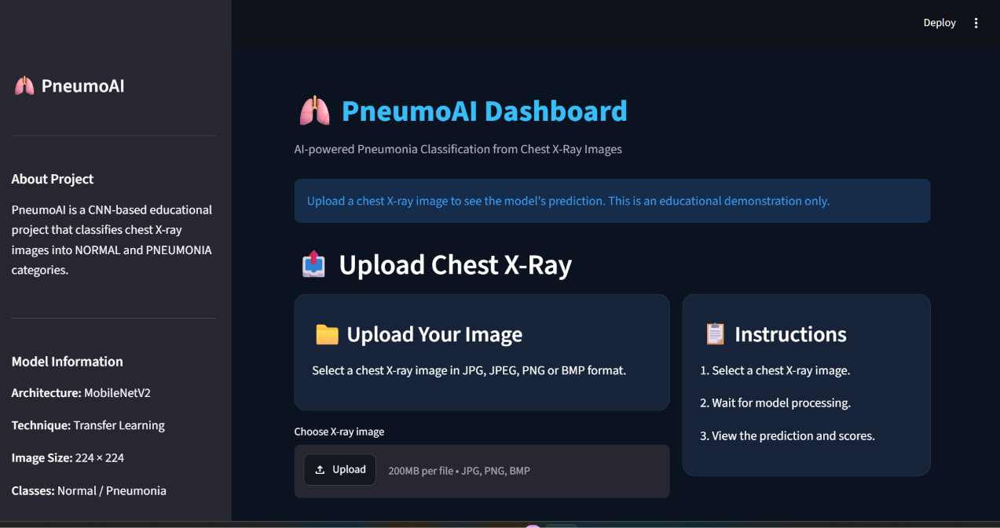
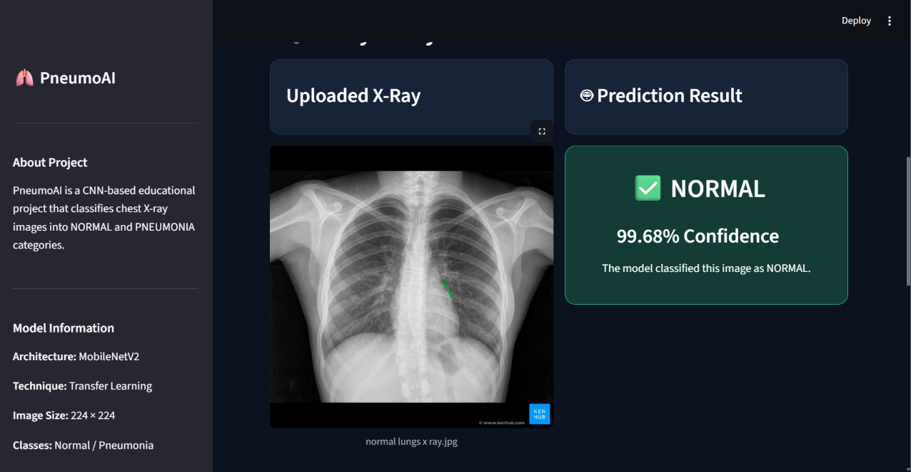
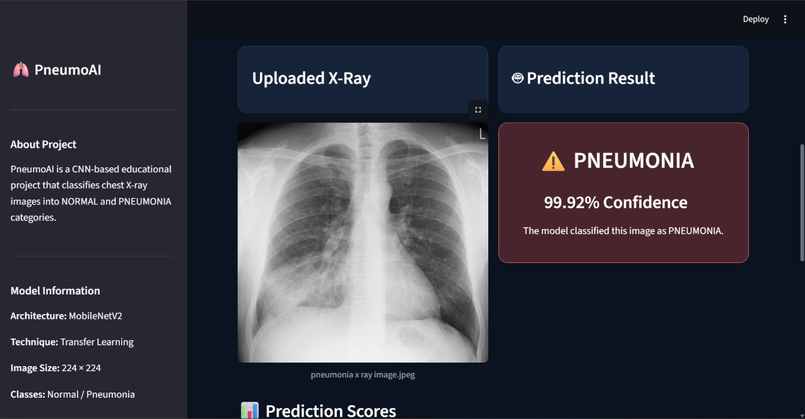

# 🫁 PneumoAI – Pneumonia X-Ray Classification

**PneumoAI** is a Deep Learning-based educational project that classifies chest X-ray images into two categories: **NORMAL** and **PNEUMONIA**.

The project uses a CNN-based MobileNetV2 transfer learning model built with TensorFlow/Keras and an interactive web application developed using Streamlit.

## 🚀 Project Overview

The objective of this project is to demonstrate how Deep Learning can be integrated with a web application for chest X-ray image classification.

Users can upload a chest X-ray image and view the predicted class, confidence score, probability scores, and prediction history through an interactive dashboard.

## ✨ Key Features

- Upload chest X-ray images.
- Classify images into NORMAL and PNEUMONIA categories.
- MobileNetV2 transfer learning model.
- Interactive Streamlit dashboard.
- Uploaded image preview.
- Prediction confidence and probability scores.
- Prediction history.
- Clear uploaded image functionality.
- Clear prediction history functionality.

## 🖥️ Application Screenshots

### 1. Dashboard



### 2. NORMAL Prediction



### 3. PNEUMONIA Prediction



### 4. Prediction History


## 🧠 Model Architecture

The project uses **MobileNetV2 Transfer Learning** with TensorFlow/Keras.

| Component | Details |
|---|---|
| Model | MobileNetV2 |
| Technique | Transfer Learning |
| Input Image Size | 224 × 224 |
| Image Format | Grayscale |
| Output Classes | NORMAL, PNEUMONIA |
| Framework | TensorFlow / Keras |
| Classification | Binary Classification |

### Model Performance

Reported results from the original project's evaluation:

| Metric | Result |
|---|---:|
| Accuracy | 90.54% |
| ROC-AUC | 0.962 |
| Sensitivity | 96.67% |
| Specificity | 80.34% |

**Evaluation limitation:** The test set was also used as validation data during training and early stopping. Therefore, these results may be optimistic and should not be interpreted as independent clinical performance.

## 🛠️ Technologies Used

- Python
- TensorFlow
- Keras
- MobileNetV2
- Streamlit
- NumPy
- Pandas
- Matplotlib
- Seaborn
- Scikit-learn
- Pillow

## 📂 Project Structure

```text
PneumoAI-Pneumonia-Detection/
│
├── app.py
├── requirements.txt
├── README.md
├── LICENSE
│
├── models/
│   └── pneumonia_mobilenetv2.keras
│
├── notebooks/
│
└── screenshots/
    ├── dashboard.png
    ├── normal.png
    ├── pneumonia.png
    └── result&histoory.png
```

## ⚙️ Installation and Setup

### 1. Clone the repository

```bash
git clone https://github.com/anshika9471/PneumoAI-Pneumonia-Detection.git
```

### 2. Open the project folder

```bash
cd PneumoAI-Pneumonia-Detection
```

### 3. Create a virtual environment

```bash
python -m venv venv
```

### 4. Activate the environment

For Windows:

```bash
venv\Scripts\activate
```

### 5. Install dependencies

```bash
pip install -r requirements.txt
```

### 6. Run the Streamlit application

```bash
streamlit run app.py
```

The application will open in your browser at:

`http://localhost:8501`

## ⚠️ Limitations

- The model is trained on a specific chest X-ray dataset.
- The reported evaluation metrics have validation limitations.
- The application may generate predictions for images that are not chest X-rays.
- Performance on external datasets has not been established.
- The model is not clinically validated.

## 🔮 Future Improvements

- Add Grad-CAM visualizations.
- Improve model evaluation using an independent validation set.
- Fine-tune the MobileNetV2 architecture.
- Improve image validation.
- Deploy the application online.
- Explore additional deep learning architectures.

## 👩‍💻 Project Contribution

**Project:** PneumoAI – Pneumonia X-Ray Classification

**Group ID:** BT_DL_05

**Dashboard Development & Integration:** Anshika Agarwal

This project focuses on integrating the trained classification model into an interactive Streamlit dashboard and developing user-facing features.


The original project's applicable license and attribution requirements are retained. The dashboard integration and interface enhancements are part of this project's development.

## ⚕️ Disclaimer

This project is developed strictly for educational and academic demonstration purposes.

It is not a medical device and must not be used for medical diagnosis, treatment decisions, or clinical purposes.